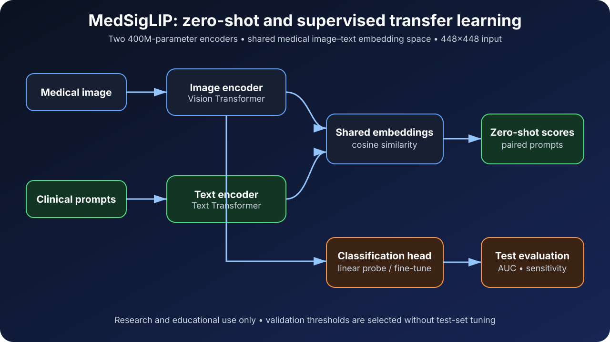
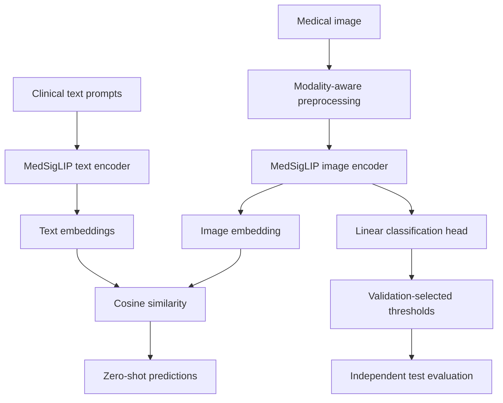
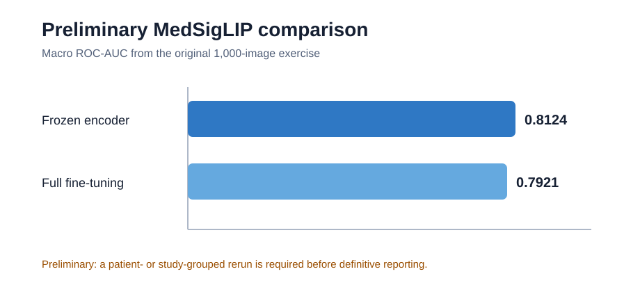

# MedSigLIP Medical Image Classification

[](https://github.com/Kanika-Bhalla/medsiglip-medical-image-classification/actions/workflows/ci.yml)
[](https://www.python.org/)
[](LICENSE)

Leakage-aware transfer learning and zero-shot medical image classification with
[MedSigLIP](https://huggingface.co/google/medsiglip-448).

This portfolio project demonstrates a complete medical vision-language workflow:

- zero-shot image-text matching;
- extraction of pretrained medical image representations;
- frozen-encoder linear probing;
- parameter-efficient LoRA adaptation;
- full encoder fine-tuning;
- validation-set threshold selection with Youden's index; and
- independent test-set ROC-AUC, sensitivity, and specificity evaluation.

> **Portfolio contribution:** Implemented and modified the end-to-end pipeline,
> including paired-prompt zero-shot inference, leakage-aware dataset splitting,
> frozen and trainable encoder experiments, threshold selection, and evaluation.

## Why this project matters

Medical datasets often contain several images from the same patient or study.
Randomly splitting image rows can leak related images across train, validation,
and test sets. This implementation provides a group-aware split utility so that
all images from the same patient (preferred) or study remain in one partition.

## Dual-encoder architecture and downstream pipeline

MedSigLIP is a dual-encoder vision-language model. During zero-shot inference,
the image encoder and text encoder independently map images and clinical text
prompts into a shared embedding space. Cosine similarity between the two
embeddings provides the zero-shot class scores. During supervised transfer
learning, this project reuses the pretrained image encoder and adds a trainable
classification head; the text encoder is not required for that branch.





### How the two branches are used

| Branch | Image encoder | Text encoder | Output |
|---|---:|---:|---|
| Zero-shot image-text classification | Yes | Yes | Similarity-based class scores |
| Frozen-encoder linear probe | Frozen | No | Supervised class logits |
| LoRA adaptation | Low-rank attention adapters | No | Supervised class logits |
| Full fine-tuning | Trainable | No | Supervised class logits |

## Zero-shot image-text inference

The runnable zero-shot workflow uses both MedSigLIP towers. For every finding,
it compares a positive prompt with a negative prompt and normalizes that pair
independently, which is more appropriate than forcing co-occurring chest
findings into a mutually exclusive softmax.

```bash
python scripts/zero_shot.py \
  --image /path/to/deidentified_cxr.png \
  --labels cardiomegaly "pleural effusion" pneumothorax "pulmonary edema" \
  --output examples/zero_shot_output.json
```

The model is gated. Accept its terms on Hugging Face and run `hf auth login`
before first use. See [`examples/`](examples/) for the output schema.

## Preliminary exercise results

The original 1,000-image EmoryCXR training exercise compared a frozen vision
encoder with full fine-tuning across five findings. The saved notebook reported:

| Approach | Macro ROC-AUC |
|---|---:|
| Frozen encoder / linear probe | 0.8124 |
| Full fine-tuning | 0.7921 |



These values are retained for transparent documentation, but they are **not
presented as final validated performance**. The original exercise assigned
individual image rows to 600/200/200 splits. A patient- or study-grouped rerun
is required before making a definitive performance claim.

## Repository structure

```text
.
├── src/medsiglip/
│   ├── data.py              # Image preprocessing and PyTorch Dataset
│   ├── evaluation.py        # ROC-AUC and Youden-threshold evaluation
│   ├── prompts.py           # Positive/negative zero-shot prompts
│   └── model.py             # PyTorch Lightning MedSigLIP classifier
├── scripts/
│   ├── create_demo_image.py # Synthetic, non-clinical demo input
│   ├── smoke_test.py        # Environment and gated-model smoke tests
│   ├── split_dataset.py     # Group-aware 60/20/20 split generation
│   ├── train.py             # Frozen-encoder or full fine-tuning
│   ├── zero_shot.py         # Image + text encoder inference
│   └── evaluate.py          # Validation thresholding + test evaluation
├── tests/                   # Leakage, prompt, and metric tests
├── examples/                # Demo instructions and JSON schema
├── results/
│   └── preliminary_metrics.csv
└── docs/
    ├── architecture.svg
    └── preliminary_results.svg
```

## Dataset manifest

The scripts expect a CSV containing:

- `ImagePath`: relative or absolute image path;
- a patient or study identifier such as `empi_anon` or
  `AccessionNumber_anon`;
- `Pathology`: one of the target classes; and
- after splitting, `Split`: `Train`, `Valid`, or `Test`.

No EmoryCXR images, identifiers, clinical data, or model checkpoints are
distributed in this repository.

## Leakage-safe splitting

```bash
python scripts/split_dataset.py \
  --input metadata.csv \
  --output metadata_grouped_split.csv \
  --group-col empi_anon \
  --label-col Pathology
```

If a patient identifier is unavailable, use `AccessionNumber_anon` to prevent
study-level leakage.

## Installation

```bash
python -m venv .venv
source .venv/bin/activate
python -m pip install --upgrade pip
python -m pip install -e .
```

Installing with `-e .` installs both the dependencies and the local
`medsiglip` package required by the command-line scripts. For NVIDIA GPUs,
install the CUDA-enabled PyTorch build appropriate for the system using the
[official PyTorch selector](https://pytorch.org/get-started/locally/) before
running `pip install -e .`.

MedSigLIP is gated on Hugging Face. Authenticate outside the source code:

```bash
huggingface-cli login
```

Never commit access tokens, API keys, `.env` files, patient data, or model
checkpoints.

## GPU setup and verification

An NVIDIA GPU is strongly recommended. The zero-shot script accepts
`--device auto`, `--device cpu`, or `--device cuda`. Training uses one device by
default and automatically selects a safe precision mode:

| Hardware | Automatic precision |
|---|---|
| NVIDIA A100 or another BF16-capable GPU | `bf16-mixed` |
| NVIDIA V100 or another older CUDA GPU | `16-mixed` |
| CPU | `32-true` |

Verify the driver, CUDA-enabled PyTorch build, package installation, and GPU:

```bash
nvidia-smi
python -c "import torch; print('CUDA:', torch.cuda.is_available()); print('Device:', torch.cuda.get_device_name(0) if torch.cuda.is_available() else 'CPU')"
python scripts/smoke_test.py --require-cuda
```

After accepting the MedSigLIP terms and authenticating with Hugging Face, run
the complete model-download and inference smoke test:

```bash
python scripts/smoke_test.py --require-cuda --run-model --device cuda
```

This second command downloads the gated model and may take several minutes on
the first run. It uses a generated synthetic image; its scores verify execution
only and are not medical results.

## Reproducible zero-shot proof of concept

Generate a synthetic, non-clinical input and run both MedSigLIP encoders:

```bash
python scripts/create_demo_image.py --output examples/synthetic_cxr.png

python scripts/zero_shot.py \
  --image examples/synthetic_cxr.png \
  --labels cardiomegaly "pleural effusion" pneumothorax "pulmonary edema" \
  --device cuda \
  --output examples/zero_shot_output.json
```

For a meaningful research demonstration, replace the synthetic file with a
properly de-identified image that you are authorized to use. Do not interpret
the synthetic-image probabilities clinically.

## Training

Frozen encoder / linear probe:

```bash
python scripts/train.py \
  --csv metadata_grouped_split.csv \
  --image-root /path/to/images \
  --output-dir outputs/linear_probe \
  --adaptation-mode frozen \
  --batch-size 4 \
  --accumulate-grad-batches 4 \
  --precision auto
```

LoRA adaptation of the vision encoder:

```bash
python scripts/train.py \
  --csv metadata_grouped_split.csv \
  --image-root /path/to/images \
  --output-dir outputs/lora \
  --adaptation-mode lora \
  --lora-r 8 \
  --lora-alpha 16 \
  --lora-dropout 0.05 \
  --batch-size 4 \
  --accumulate-grad-batches 4 \
  --precision auto
```

Full fine-tuning:

```bash
python scripts/train.py \
  --csv metadata_grouped_split.csv \
  --image-root /path/to/images \
  --output-dir outputs/full_finetuning \
  --adaptation-mode full \
  --learning-rate 1e-5 \
  --batch-size 2 \
  --accumulate-grad-batches 8 \
  --precision auto
```

The accumulated effective batch sizes in these examples are 16. Reduce the
physical batch size if GPU memory is limited. Use `--fast-dev-run` to execute
one training and validation batch before launching a full experiment. You can
override automatic selection with `--precision bf16-mixed` on A100-class GPUs
or `--precision 16-mixed` on V100-class GPUs.

### LoRA implementation

LoRA is the parameter-efficient middle ground between a frozen linear probe
and full fine-tuning. The implementation freezes the original MedSigLIP vision
weights and inserts trainable low-rank matrices into the attention `q_proj` and
`v_proj` layers. The classification head remains trainable. The default
configuration is rank 8, alpha 16, and dropout 0.05; target modules are
configurable with `--lora-target-modules`.

Every run prints the total parameter count, trainable parameter count, and
trainable percentage. LoRA training also exports:

```text
outputs/lora/lora_bundle/
├── vision_adapter/       # PEFT adapter weights and configuration
└── classifier_head.pt    # Class labels and supervised head weights
```

Verify adapter attachment before a full experiment:

```bash
python scripts/smoke_test.py --require-cuda --check-lora --device cuda
```

Use the same patient-grouped folds, seed, preprocessing, validation threshold
selection, and independent test set for all three strategies. Report macro
ROC-AUC alongside trainable parameters, peak GPU memory, and training time so
the accuracy-efficiency trade-off is transparent.

| Adaptation strategy | Macro ROC-AUC | Trainable parameters | Peak GPU memory | Training time |
|---|---:|---:|---:|---:|
| Frozen linear probe | Run grouped experiment | Logged automatically | Record during run | Record during run |
| LoRA | Run grouped experiment | Logged automatically | Record during run | Record during run |
| Full fine-tuning | Run grouped experiment | Logged automatically | Record during run | Record during run |

## Evaluation

```bash
python scripts/evaluate.py \
  --csv metadata_grouped_split.csv \
  --image-root /path/to/images \
  --checkpoint outputs/linear_probe/best.ckpt \
  --output results/grouped_test_metrics.json
```

Thresholds are selected on the validation split and applied once to the test
split. The test split is never used to choose thresholds or hyperparameters.

## Attribution

Portfolio implementation and pipeline modifications: **Kanika Bhalla, PhD**.

This work builds on:

- Google's MedSigLIP model and public quick-start materials;
- the Emory Health AI Datathon 2025 instructional workflow developed by Frank
  Li and collaborators at the HITI Lab; and
- the public SCIN dataset for the original dermatology demonstration.

The code in this repository is a cleaned portfolio implementation. It is not an
official Google, Emory University, or HITI Lab repository.

## Responsible-use statement

This repository is for research and educational use only. It is not a medical
device and must not be used for diagnosis or patient-care decisions.

